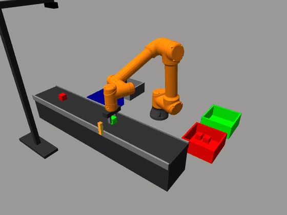
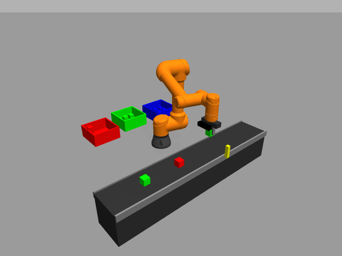
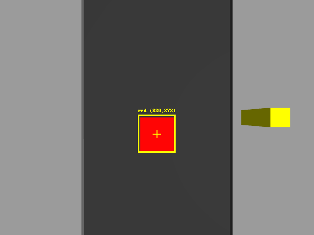
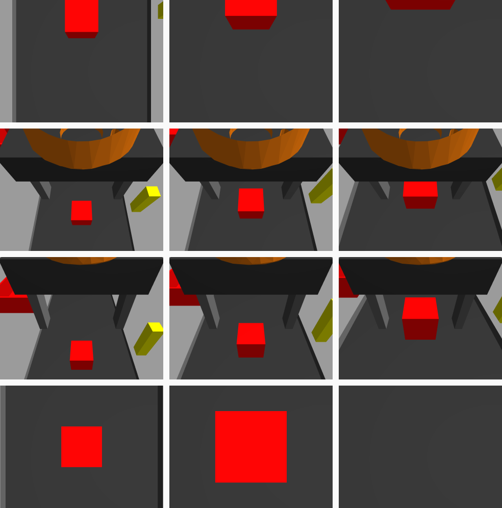
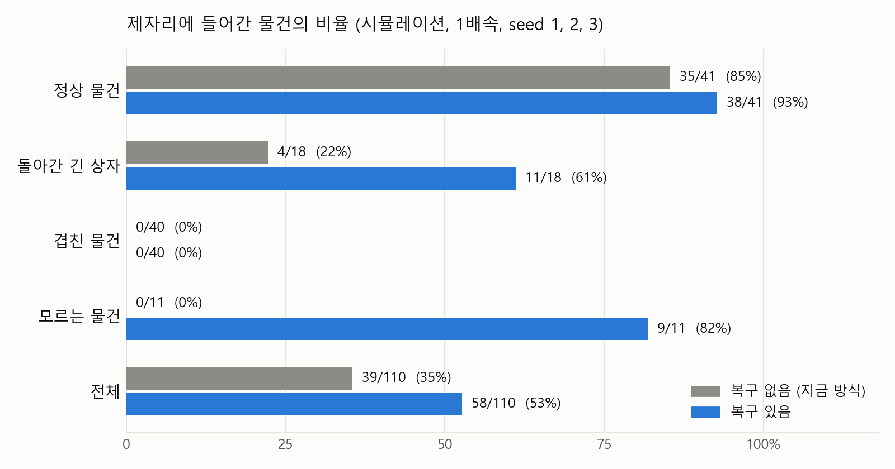
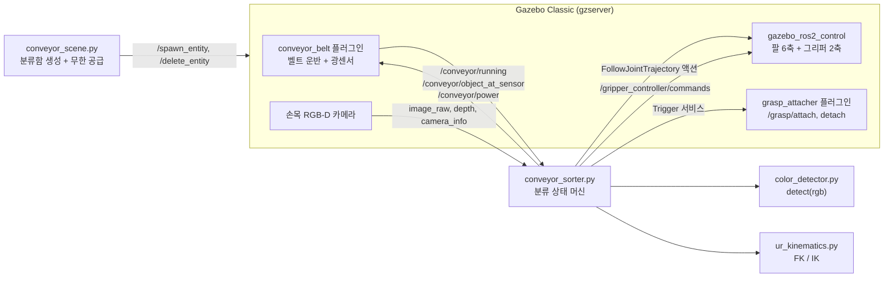

# UR5e 컨베이어 비전 분류 셀 (ROS 2 Humble · Gazebo)

> 컨베이어로 끝없이 들어오는 물건을 협동로봇 UR5e가 **벨트를 멈추지 않고 카메라로 인식해 집어서** **색깔별 분류함으로 분류**하는 물류 공정 시뮬레이션입니다.
> *UR5e vision-based conveyor tracking and sorting cell in ROS 2 Humble + Gazebo Classic.*



<sub>벨트 10 cm/s, 물건 간격 50 cm, 실제 속도로 재생</sub>

## 결과 요약

| 항목 | 이전 (물건마다 벨트 정지) | 지금 (벨트 추적) |
|---|---|---|
| 물건 1개 처리 시간 | 약 19초 | **5.13초** |
| 시간당 처리량 | 약 190개 | **약 700개** |
| 분류 정확도 | 12 / 12 | **40 / 40** (Gazebo 실제 위치로 채점) |
| 놓친 물건 | 0 | **0** |

벨트 10 cm/s, 물건 간격 50 cm 기준입니다. 시험한 조건 중 놓침 없이 처리량이 가장 높았지만 여유는 거의 없습니다. 단색 큐브를 쓴 시뮬레이션 값이며 동역학은 반영하지 않았습니다.

아래 사진은 벨트 정지 방식일 때의 화면입니다.

| 전체 셀 | 로봇 손목 카메라의 시점 (인식 결과) |
|---|---|
|  |  |

## 주요 기능

- **커스텀 Gazebo 플러그인 2종 (C++)**
  - `conveyor_belt`: 벨트 위 물체 운반, **광센서(light curtain)** 감지 시 자동 정지, ROS 2 서비스로 재가동
  - `grasp_attacher`: 손가락 사이 물체를 손목에 fixed joint로 고정해서 잡기를 안정화
- **비전 파이프라인**: RGB 색 분할 → 깊이 영상 → 카메라 내부 파라미터로 3D 복원 → TF로 월드 좌표 변환
- **운동학 직접 구현**: UR5e DH 순기구학 + 감쇠 최소자승(DLS) 수치 역기구학. ROS TF와 위치·자세가 일치하는 것을 검증
- **교체 가능한 인식 모듈**: `detect(rgb) -> [label, u, v]` 인터페이스로 분리해서 VLM(예: Gemini Robotics-ER)으로 바꿔 끼울 수 있게 설계
- **실행 환경 자동 정리**: 남은 프로세스 정리, WSL2 렌더링 우회, 로그 저장을 `run_sim.sh` 하나로 처리

## 벨트를 멈추지 않는 분류 (컨베이어 트래킹)

벨트 위쪽에 고정 카메라를 두어 물건을 미리 찾고, 벨트 이동 거리(엔코더)로 위치를 예측해 움직이는 물건을 그대로 집습니다. 물건마다 `s = y - 엔코더` 값 하나만 기억하면 어느 시점의 위치든 계산할 수 있어, 시뮬레이션 속도가 달라져도 예측이 틀어지지 않습니다.

```bash
bash run_sim.sh ur5e scene:=conveyor continuous:=true belt_speed:=0.1 item_spacing:=0.5
ros2 run ur_pick_place tracking_sorter.py --cycles 40
```

| 조건 (실시간 측정) | 물건 수 | 집기 성공 · 색 일치 | 놓침 | 평균 사이클 | 시간당 처리량 |
|---|---|---|---|---|---|
| 5 cm/s, 간격 50 cm | 12 | 12 | 0 | 9.96초 (공급 속도에 맞춤) | 약 360개 |
| 10 cm/s, 간격 50 cm | 40 | 40 | 0 | 5.13초 | 약 700개 |

- 관절 속도 180°/s, 가속도 3 rad/s²로 제한한 값입니다. 가속도는 가정값이고, 동역학은 반영하지 않습니다.
- 간격을 45 cm · 40 cm로 좁히면(2배속 측정) 각각 3개 · 8개를 놓쳤고 사이클은 약 5.1초로 같았습니다. **이 조건의 로봇 한계는 약 5.1초, 시간당 약 700개**이며, 10 cm/s · 50 cm는 여유가 거의 없습니다.
- 40개 시험은 Gazebo의 실제 위치로 채점해 40 / 40이 맞는 분류함에 들어갔습니다.
- 빠른 라인을 대체하는 속도는 아닙니다. 업계 자료의 SCARA · 델타 로봇은 분당 수십~수백 개를 처리합니다.

### 손목 카메라 위치

네 위치에서 물건 위로 내려가며 화면을 비교했습니다(위부터 옆, 올림, 올려서 바깥으로 뺌, 그리퍼 중앙 / 왼쪽부터 물건 위 10cm, 5cm, 집는 순간). 기본값은 **올려서 바깥으로 뺀 위치**(`raised_wide`)입니다. 물건이 집는 순간까지 손가락 사이에 온전히 보이고, 팔이 화면을 거의 가리지 않습니다. 원래 옆 위치는 집는 순간 물건이 화면 끝에 걸리고, 중앙 위치는 영상 중심이 집는 지점과 일치하지만 집는 높이에서는 물건이 보이지 않습니다.



벨트 추적 자체는 벨트 카메라만 씁니다. 손목 카메라를 집기 직전 확인에 쓰는 일은 다음 단계입니다. 기존 `conveyor_sorter.py`는 `UR_WRIST_CAMERA_MOUNT=side`로 실행하세요.

## Gemini Robotics-ER 연동 (말로 분류 규칙 주기)

인식 모듈을 비전-언어 모델 **Gemini Robotics-ER 2**로 바꿔 끼울 수 있습니다. 같은 `detect(rgb)` 인터페이스라 분류 로봇 코드는 그대로이고, **자연어로 분류 규칙**을 줄 수 있습니다.

```bash
ros2 run ur_pick_place conveyor_sorter.py --detector gemini
ros2 run ur_pick_place conveyor_sorter.py --detector gemini --rule "초록색 물건은 파란 분류함에 넣고, 나머지는 같은 색 분류함에 넣어"
```

| 시험 | 결과 |
|---|---|
| 기본 규칙(같은 색) | **4 / 4 정답**, 위치는 색 인식과 1픽셀 차이 |
| 자연어 규칙("초록 → 파란 분류함") | **6 / 6 정답**: 초록 상자를 "green block"으로 인식하면서 규칙대로 파란 분류함에 넣음 |
| 응답 시간 | 물건당 약 5~6초 (벨트가 멈춘 동안 호출) |

- Gemini 호출이 실패하면 자동으로 색 인식으로 대신해서 라인이 멈추지 않습니다.
- API 키는 `GEMINI_API_KEY` 환경 변수나 `~/.gemini_api_key` 파일에서 읽습니다(저장소에 넣지 않음).

## 예외 처리 실험 (멈추지 않는 벨트)

돌아간 긴 상자, 겹친 물건, 모르는 물건, 집기 미끄러짐 10%, 운반 중 떨어뜨림 5%를 섞어 넣고, 집기에 실패했을 때 로봇이 스스로 다시 집게 했습니다. 벨트가 멈추지 않으므로 "멈춘 시간" 대신 **제자리에 들어간 물건 수**로 비교합니다.

```bash
bash tools/exception_trial.sh baseline 1     # 복구 없음 (tracking_sorter.py 그대로), seed 1
bash tools/exception_trial.sh recovery 1     # 복구 있음 (recovery_sorter.py)
```

| 시뮬레이션, 1배속, seed 1~3, 공급 90번 | 복구 없음 | 복구 있음 |
|---|---|---|
| 제자리에 들어간 물건 | 39 / 110 (35%) | **58 / 110 (53%)** |
| 시간당 정상 분류 | 312개 | **464개** |
| 다시 집어 성공 | 0 | 12번 (평균 2.0초) |

- 로봇은 그리퍼 물체 센서와 손목 카메라만 씁니다. 손목 카메라의 깊이 영상 한 장으로 물건 1개 / 긴 상자 / 붙은 2개 / 쌓인 2개를 가려, 미끄러지면 다시 집고 긴 상자는 그리퍼를 돌려 집습니다.
- 겹친 물건 40개는 한 개도 건지지 못했습니다(알아채고 흘려보냄). 다시 집기는 물건이 집는 구간(4초) 안에 있을 때만 가능했습니다.
- Gemini 진단 훅은 연습 모드(보낼 사진과 질문만 저장)로만 돌렸고, 실제 호출은 하지 않았습니다.



숫자와 측정 방법, 확인하지 못한 것은 [예외 처리 실험 보고서](docs/exception_nonstop_report.md)에, 과정은 [개발 일지 9장](docs/devlog.md)에 있습니다.

## 시스템 구성



**분류 사이클**: 벨트가 광센서에서 정지 → 카메라로 색·위치 인식 → 하강·집기·고정 → 상승 후 **벨트 재가동**(다음 물건 이동) → 색별 분류함의 3×3 칸에 차례로 놓기 → 감시 자세로 복귀

## 개발 과정

문제를 어떻게 진단하고 해결했는지는 **[개발 일지 (docs/devlog.md)](docs/devlog.md)** 에 정리했습니다. 주요 내용:

1. **controller_manager 무응답** → 로그 분석으로 gzserver segfault 확인 → 구성 요소를 하나씩 꺼서 원인을 좁힘 → WSL2 GPU 드라이버와 깊이 카메라의 충돌로 특정, 소프트웨어 렌더링으로 해결
2. **잡기 불안정** → position 제어 관절이 순간이동한다는 점을 파악하고 grasp 플러그인 작성
3. **MoveIt 없이 픽앤플레이스** → FK를 TF로 검증한 뒤 수치 IK와 직선 경로 구현
4. **컨베이어 셀** → 테스트 중 버그 4개를 발견하고 수정 (월드 조명 누락, 피더 시작 경쟁 조건, 분류함 적층, IK 시작값 부호)

## 실행 방법

**환경**: Ubuntu 22.04 (WSL2에서도 동작), ROS 2 Humble, Gazebo Classic 11

```bash
# 1) 의존 패키지
sudo apt install ros-humble-ur ros-humble-gazebo-ros-pkgs ros-humble-gazebo-ros2-control \
  ros-humble-ros2-controllers python3-opencv
mkdir -p ~/ros2_ws/src && cd ~/ros2_ws/src
git clone https://github.com/hyungyu0820/ur5e-conveyor-sorting.git ur_pick_place
git clone -b humble https://github.com/UniversalRobots/Universal_Robots_ROS2_Gazebo_Simulation.git

# 2) 컨베이어 분류 셀 실행 (빌드 포함)
bash ~/ros2_ws/src/ur_pick_place/run_sim.sh ur5e scene:=conveyor continuous:=true belt_speed:=0.1 item_spacing:=0.5

# 3) 다른 터미널에서 분류 시작 (Ctrl+C로 종료, --cycles N이면 N개 후 종료)
source ~/ros2_ws/install/setup.bash
ros2 run ur_pick_place tracking_sorter.py

# 끝낼 때
bash ~/ros2_ws/src/ur_pick_place/stop_sim.sh
```

단일 픽앤플레이스, 물건 생성, 토픽 목록, 문제 해결 방법은 **[사용 설명서 (docs/usage.md)](docs/usage.md)** 를 참고하세요.

## 폴더 구조

```
ur_pick_place/
├── run_sim.sh                  # 정리 + 빌드 + 실행 + 로그 저장
├── launch/ur_gripper_sim.launch.py   # scene:=table | conveyor
├── urdf/                       # UR5e + 평행 그리퍼 + 손목 RGB-D 카메라 (xacro)
├── config/                     # ros2_control 컨트롤러 설정
├── src/
│   ├── conveyor_belt.cpp       # Gazebo 플러그인: 컨베이어 + 광센서
│   └── grasp_attacher.cpp      # Gazebo 플러그인: 잡기 안정화
├── scripts/
│   ├── conveyor_sorter.py      # 분류 로봇 (벨트 정지 방식)
│   ├── tracking_sorter.py      # 분류 로봇 (벨트를 멈추지 않는 방식)
│   ├── recovery_sorter.py      # 위에 실패 복구 규칙을 더한 것
│   ├── wrist_check.py          # 손목 카메라로 물건 모양 재기
│   ├── gemini_diagnosis.py     # 진단 훅 (기본은 호출 없이 기록만)
│   ├── exception_metrics.py    # 예외 실험용 실제 기록 저장
│   ├── score_bins.py           # Gazebo 실제 위치로 분류 결과 채점
│   ├── conveyor_scene.py       # 분류함 생성 + 무한 공급
│   ├── color_detector.py       # 인식 모듈 (교체 가능)
│   ├── conveyor_layout.py      # 셀 배치 좌표
│   ├── ur_kinematics.py        # UR5e FK / IK
│   ├── pick_place.py           # 단일 픽앤플레이스
│   ├── spawn_object.py, gripper.py
├── models/                     # 컨베이어, 분류함, 큐브, 테이블, 녹화용 카메라 (SDF)
├── tools/                      # 시뮬레이터 없는 기구학 검사, 시험 자동 실행
└── docs/                       # 개발 일지, 사용 설명서, 시연 미디어
```

## 한계와 다음 단계

**현재 한계**
- 잡기는 물리 마찰이 아니라 고정 joint 방식입니다. 시뮬레이터의 position 제어 특성 때문이며, 실기에서는 실제 그리퍼의 힘 제어가 필요합니다.
- 인식은 단색 큐브용 색 임계값 방식이고, 물체 방향(yaw)은 정렬돼 있다고 가정합니다.
- 관절 속도와 가속도를 궤적에 직접 제한했고 가속도는 가정값입니다. 동역학은 반영하지 않아 실제 로봇의 사이클은 달라질 수 있습니다.
- 시뮬레이션에 사람이 없고, 협동 안전 기능(충돌 감지, 속도 제한)은 구현하지 않았습니다.
- Gazebo Classic은 2025년 1월에 지원이 종료되었습니다.

**로드맵**
1. ~~인식 모듈을 Gemini Robotics-ER(VLM)로 교체~~ ✅ 완료. 다음: 모양 · 종류가 다양한 물건으로 확장
2. **NVIDIA Isaac Sim**으로 이전: 사실적 렌더링과 물리, ROS 2 브리지
3. **Isaac Lab**으로 학습 기반 잡기 (강화학습 / 모방학습)

## 기술 스택

ROS 2 Humble · Gazebo Classic 11 · ros2_control · C++ (Gazebo 플러그인) · Python (rclpy, NumPy, OpenCV) · TF2 · xacro/URDF/SDF

## 라이선스

Apache-2.0. UR 로봇 모델은 [Universal Robots ROS 2 패키지](https://github.com/UniversalRobots)를 사용합니다.
