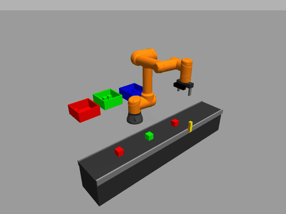
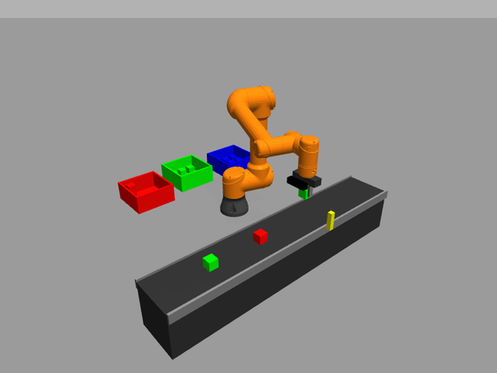
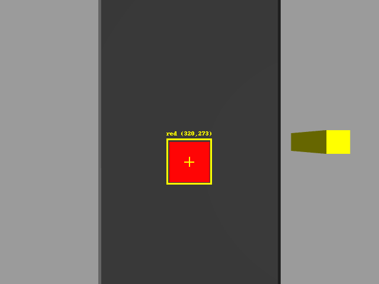
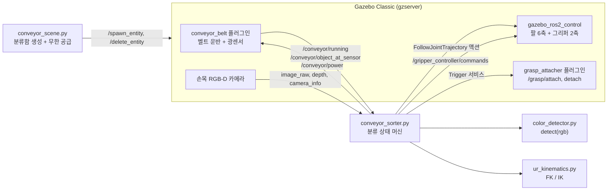

# UR5e 컨베이어 비전 분류 셀 (ROS 2 Humble · Gazebo)

> 컨베이어로 끝없이 들어오는 물건을 협동로봇 UR5e가 **손목 카메라로 인식**해서 **색깔별 분류함으로 분류**하는 물류 공정 시뮬레이션입니다.
> *UR5e vision-based conveyor sorting cell in ROS 2 Humble + Gazebo Classic.*



<sub>실제 속도보다 약 10배 빠르게 재생됨 (소프트웨어 렌더링 환경에서 녹화)</sub>

## 결과 요약

| 항목 | 결과 |
|---|---|
| 연속 분류 정확도 | **12 / 12 (100%)**: 물건 이름의 정답 색과 실제로 들어간 분류함을 Gazebo 좌표로 자동 채점 |
| 카메라 위치 추정 오차 | **약 1 mm**: 인식 (0.499, -0.019) / 실제 (0.500, -0.020) m |
| 사이클 타임 | 물건 1개당 **약 19초** (인식 → 집기 → 분류 → 복귀) |
| 공급 | 무한 공급 (벨트 25 cm 이동마다 1개, 오래된 물건 자동 정리) |

| 전체 셀 | 로봇 손목 카메라의 시점 (인식 결과) |
|---|---|
|  |  |

## 주요 기능

- **커스텀 Gazebo 플러그인 2종 (C++)**
  - `conveyor_belt`: 벨트 위 물체 운반, **광센서(light curtain)** 감지 시 자동 정지, ROS 2 서비스로 재가동
  - `grasp_attacher`: 손가락 사이 물체를 손목에 fixed joint로 고정해서 잡기를 안정화
- **비전 파이프라인**: RGB 색 분할 → 깊이 영상 → 카메라 내부 파라미터로 3D 복원 → TF로 월드 좌표 변환
- **운동학 직접 구현**: UR5e DH 순기구학 + 감쇠 최소자승(DLS) 수치 역기구학. ROS TF와 위치·자세가 일치하는 것을 검증
- **교체 가능한 인식 모듈**: `detect(rgb) -> [label, u, v]` 인터페이스로 분리해서 VLM(예: Gemini Robotics-ER)으로 바꿔 끼울 수 있게 설계
- **실행 환경 자동 정리**: 남은 프로세스 정리, WSL2 렌더링 우회, 로그 저장을 `run_sim.sh` 하나로 처리

## 시스템 구성



**분류 사이클**: 벨트가 광센서에서 정지 → 카메라로 색·위치 인식 → 하강·집기·고정 → 상승 후 **벨트 재가동**(다음 물건 이동) → 색별 분류함의 3×3 칸에 차례로 놓기 → 감시 자세로 복귀

## 개발 과정

문제를 어떻게 진단하고 해결했는지는 **[개발 일지 (docs/devlog.md)](docs/devlog.md)** 에 정리했습니다. 주요 내용:

1. **controller_manager 무응답** → 로그 분석으로 gzserver segfault 확인 → 구성 요소를 하나씩 꺼서 원인을 좁힘 → WSL2 GPU 드라이버와 깊이 카메라의 충돌로 특정, 소프트웨어 렌더링으로 해결
2. **잡기 불안정** → position 제어 관절이 순간이동한다는 점을 파악하고 grasp 플러그인 작성
3. **MoveIt 없이 픽앤플레이스** → FK를 TF로 검증한 뒤 수치 IK와 직선 경로 구현
4. **컨베이어 셀** → 테스트 중 버그 4개를 발견하고 수정 (월드 조명 누락, 피더 시작 경쟁 조건, 분류함 적층, IK 시작값 부호)

## 실행 방법

**환경**: Ubuntu 22.04 (WSL2에서도 동작), ROS 2 Humble, Gazebo Classic 11

```bash
# 1) 의존 패키지
sudo apt install ros-humble-ur ros-humble-gazebo-ros-pkgs ros-humble-gazebo-ros2-control \
  ros-humble-ros2-controllers python3-opencv
mkdir -p ~/ros2_ws/src && cd ~/ros2_ws/src
git clone https://github.com/hyungyu0820/ur5e-conveyor-sorting.git ur_pick_place
git clone -b humble https://github.com/UniversalRobots/Universal_Robots_ROS2_Gazebo_Simulation.git

# 2) 컨베이어 분류 셀 실행 (빌드 포함)
bash ~/ros2_ws/src/ur_pick_place/run_sim.sh ur5e scene:=conveyor

# 3) 다른 터미널에서 분류 시작
source ~/ros2_ws/install/setup.bash
ros2 run ur_pick_place conveyor_sorter.py
```

단일 픽앤플레이스, 물건 생성, 토픽 목록, 문제 해결 방법은 **[사용 설명서 (docs/usage.md)](docs/usage.md)** 를 참고하세요.

## 폴더 구조

```
ur_pick_place/
├── run_sim.sh                  # 정리 + 빌드 + 실행 + 로그 저장
├── launch/ur_gripper_sim.launch.py   # scene:=table | conveyor
├── urdf/                       # UR5e + 평행 그리퍼 + 손목 RGB-D 카메라 (xacro)
├── config/                     # ros2_control 컨트롤러 설정
├── src/
│   ├── conveyor_belt.cpp       # Gazebo 플러그인: 컨베이어 + 광센서
│   └── grasp_attacher.cpp      # Gazebo 플러그인: 잡기 안정화
├── scripts/
│   ├── conveyor_sorter.py      # 분류 로봇 (메인)
│   ├── conveyor_scene.py       # 분류함 생성 + 무한 공급
│   ├── color_detector.py       # 인식 모듈 (교체 가능)
│   ├── conveyor_layout.py      # 셀 배치 좌표
│   ├── ur_kinematics.py        # UR5e FK / IK
│   ├── pick_place.py           # 단일 픽앤플레이스
│   ├── spawn_object.py, gripper.py
├── models/                     # 컨베이어, 분류함, 큐브, 테이블, 녹화용 카메라 (SDF)
└── docs/                       # 개발 일지, 사용 설명서, 시연 미디어
```

## 한계와 다음 단계

**현재 한계**
- 잡기는 물리 마찰이 아니라 고정 joint 방식입니다. 시뮬레이터의 position 제어 특성 때문이며, 실기에서는 실제 그리퍼의 힘 제어가 필요합니다.
- 인식은 단색 큐브용 색 임계값 방식이고, 물체 방향(yaw)은 정렬돼 있다고 가정합니다.
- Gazebo Classic은 2025년 1월에 지원이 종료되었습니다.

**로드맵**
1. 인식 모듈을 **Gemini Robotics-ER**(VLM)로 교체: 자연어 분류 규칙 ("깨지기 쉬운 물건은 왼쪽")
2. **NVIDIA Isaac Sim**으로 이전: 사실적 렌더링과 물리, ROS 2 브리지
3. **Isaac Lab**으로 학습 기반 잡기 (강화학습 / 모방학습)

## 기술 스택

ROS 2 Humble · Gazebo Classic 11 · ros2_control · C++ (Gazebo 플러그인) · Python (rclpy, NumPy, OpenCV) · TF2 · xacro/URDF/SDF

## 라이선스

Apache-2.0. UR 로봇 모델은 [Universal Robots ROS 2 패키지](https://github.com/UniversalRobots)를 사용합니다.
