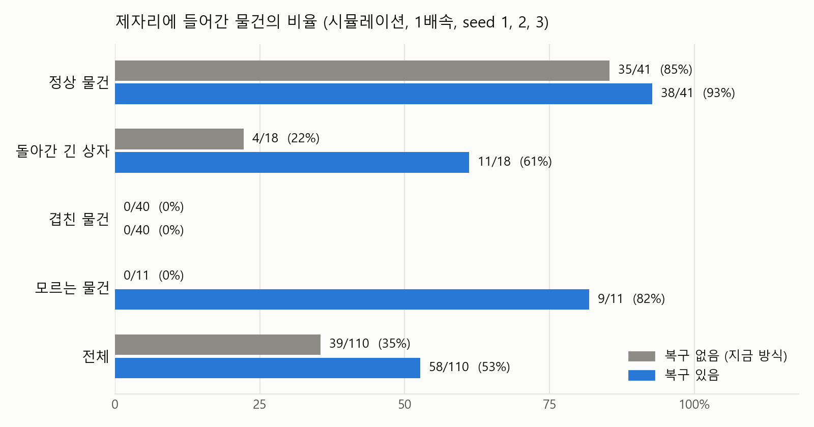
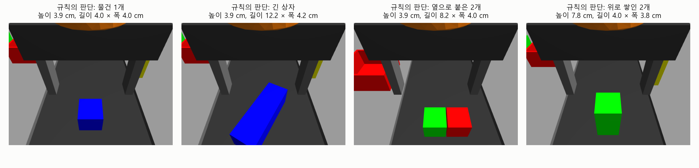
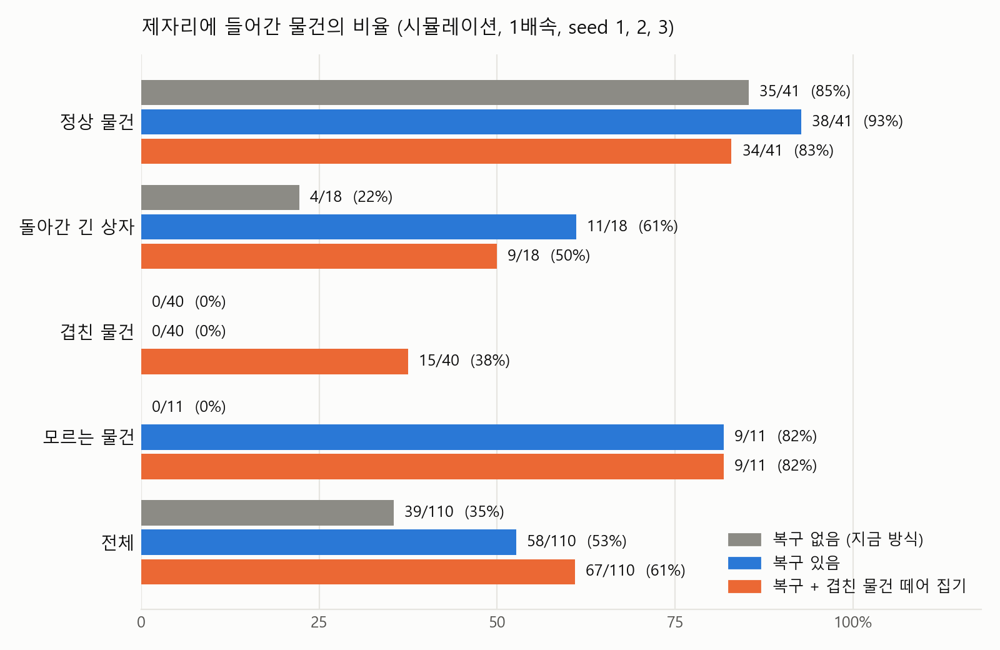
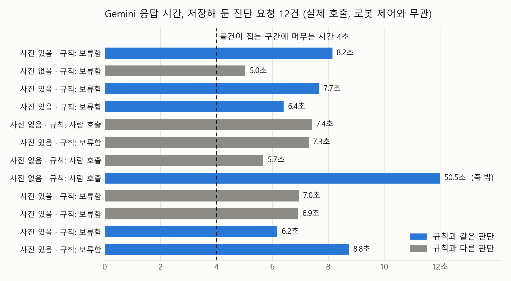
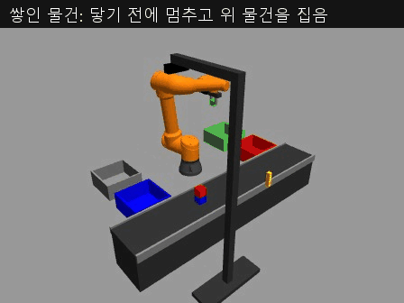

# 멈추지 않는 벨트에서의 예외 처리 실험 보고서

2026-11-11 · 브랜치 `exception-nonstop` (로컬) · Gazebo 시뮬레이션

## 한눈에

벨트 10 cm/s, 물건 간격 50 cm, 한 번에 30번 공급, seed 1·2·3, 모두 1배속으로 측정했습니다.
두 방식은 같은 물건을 같은 순서로 받고, 그리퍼의 미끄러짐·떨어뜨림도 같은 물건에서 똑같이 일어납니다.

| | 복구 없음 (지금 방식) | 복구 있음 |
|---|---|---|
| 제자리에 들어간 물건 | 39 / 110 (35%) | **58 / 110 (53%)** |
| 시간당 정상 분류 | 312개 | **464개** |
| 빈손으로 올라온 뒤 다시 잡은 횟수 | 0 | 12 (평균 2.0초) |
| 운반 중 놓친 것을 알아챔 | 0 / 2 | 3 / 3 |

**결론: 예외가 섞이면 지금 방식은 3개 중 1개만 제자리에 넣습니다. 손목 카메라로 원인을 가려 다시 집으면 2개 중 1개까지 올라갑니다. 남은 손실의 대부분은 겹친 물건(40개, 한 개도 못 건짐)입니다.**

- 세 seed 모두 같은 방향이었습니다 (11→17, 14→21, 14→20). 다만 공급 90번은 작은 표본이고, 통계 검정은 하지 않았습니다.
- 위 표를 잴 때는 Gemini를 호출하지 않았습니다. 진단 훅은 연습 모드(보낼 사진과 질문만 저장)로만 돌았습니다.
- **11/11 오전 추가 (9장):** 겹친 물건을 떼어 집는 선택 기능을 넣으면 같은 seed에서 58개가 67개(61%)로 오릅니다. 겹친 물건은 0개에서 15개가 되지만 다른 물건을 6개 더 놓칩니다. 새 seed 4~6의 결과와, 저장해 둔 요청 12건을 Gemini에 실제로 보낸 결과도 9장에 있습니다.
- 대신 정한 값들은 [decisions_made_overnight.md](decisions_made_overnight.md)에 있습니다.



## 1. 비교 기준을 어떻게 다시 정했나

예전 기준은 "예외가 나면 라인이 멈추고 사람이 30초 뒤 해결"이었습니다. 11/4에 벨트를 멈추지 않기로 정했으므로 멈춤 시간은 더 이상 잴 수 없습니다.
벨트가 멈추지 않으면 예외의 비용은 **시간이 아니라 놓친 물건**으로 나타납니다. 그래서 지표를 이렇게 바꿨습니다.

| 지표 | 정의 |
|---|---|
| 물건별 결과 | 정상 분류 / 오분류 / 떨어뜨림 / 지나감. Gazebo의 실제 위치로 판정 |
| 복구 시간 | 빈손을 알아챈 순간부터 그 물건을 다시 잡은 순간까지 (시뮬레이션 시간) |
| 처리량 | 정상 분류 수 ÷ 공급 시간 (30번 × 5초) |

- 복구 없음 = 지금의 `tracking_sorter.py` 그대로. 집기에 실패하면 손을 열고 올라가고, 물건은 벨트 끝까지 갑니다.
- 모르는 물건(보라색)은 보류함에 들어가면 정상 분류로 셉니다.
- "사람 30초"는 어디에도 넣지 않았습니다. 제자리에 못 들어간 물건 수를 사람 작업으로 환산할지는 정해 주셔야 합니다.

## 2. 어떻게 쟀나

```bash
bash tools/exception_trial.sh baseline 1 --rate 1     # 복구 없음, seed 1
bash tools/exception_trial.sh recovery 1 --rate 1     # 복구 있음, seed 1
python3 tools/exception_report.py ~/ros2_ws/log/sim/exception/{baseline,recovery}_seed{1,2,3}_rate1 --json docs/data/exception_results.json
```

- 예외 구성은 확정된 값 그대로입니다: 정상 55%, 돌아간 긴 상자 20%, 겹친 물건 15%, 모르는 물건 10%, 미끄러짐 10%, 운반 중 떨어뜨림 5%.
- 실제로 나온 것(90번 공급, 물건 110개): 정상 41, 긴 상자 18, 겹친 물건 20쌍(40개), 모르는 물건 11.
- 채점은 시뮬레이터 기록으로만 합니다. 물건의 마지막 위치와 그리퍼 플러그인의 실제 기록(잡힘, 실패 이유, 떨어뜨림)을 따로 저장하고, 로봇은 이 기록을 보지 않습니다.
- 여섯 번 모두 실시간 배율 1.00~1.02였고, 그리퍼의 고장 설정(10%, 5%, seed)이 모든 집기 기록에 찍혀 있는 것을 확인했습니다.
- 미끄러짐은 "seed + 물건 이름 + 몇 번째 시도"로 정해집니다. 두 방식에서 같은 물건의 첫 집기 결과가 46개 모두 같았습니다.
- 복구 없는 방식의 세 번을 한 번 더 돌렸을 때 결과가 같았습니다 (11, 14, 14). seed 1은 2배속에서도 11 / 38로 같았습니다.

## 3. 결과

### 3.1 종류별: 어디서 올랐고 어디서 안 올랐나

| 종류 | 물건 수 | 복구 없음 | 복구 있음 |
|---|---|---|---|
| 정상 물건 | 41 | 35 (85%) | 38 (93%) |
| 돌아간 긴 상자 | 18 | 4 (22%) | 11 (61%) |
| 겹친 물건 | 40 | 0 | 0 |
| 모르는 물건 | 11 | 0 | 9 (82%, 보류함) |
| 합계 | 110 | 39 (35%) | 58 (53%) |

**결론: 늘어난 19개는 긴 상자(+7), 모르는 물건(+9), 정상 물건(+3)에서 나왔습니다. 겹친 물건은 규칙이 일부러 건드리지 않아 그대로 0입니다.**

seed별로는 이렇습니다.

| seed | 물건 수 | 복구 없음 | 복구 있음 |
|---|---|---|---|
| 1 | 38 | 11 | 17 |
| 2 | 37 | 14 | 21 |
| 3 | 35 | 14 | 20 |

**결론: 세 번 모두 6~7개씩 늘었습니다.**

### 3.2 제자리에 못 들어간 물건은 어디로 갔나

| 결과 | 복구 없음 | 복구 있음 |
|---|---|---|
| 정상 분류 | 39 | 58 |
| 오분류 | 0 | 0 |
| 떨어뜨림 (잡았다가 분류함 밖에 떨어짐) | 1 | 1 |
| 지나감, 집기는 시도함 | 33 | 24 |
| 지나감, 손도 못 댐 | 37 | 27 |

**결론: 잘못된 분류함에 넣은 일은 두 방식 모두 없었습니다. 손실은 전부 "벨트 끝까지 흘러감"입니다.**

- "손도 못 댐"은 복구 없음에서는 겹친 물건 26개와 모르는 물건 11개(카메라가 보라색을 물건으로 보지 않음)입니다.
- 복구 있음에서는 겹친 물건 26개와 모르는 물건 1개입니다.

### 3.3 복구 한 번에 드는 시간

복구 있음에서 빈손으로 올라온 물건은 40개였습니다.

| 그 뒤 | 건수 | 걸린 시간 |
|---|---|---|
| 같은 자세로 다시 집어 성공 (미끄러짐) | 5 | 평균 1.52초 (1.5~1.6) |
| 그리퍼를 돌려 다시 집어 성공 (긴 상자) | 7 | 평균 2.41초 (2.2~2.6) |
| 다시 집었지만 또 미끄러졌고, 세 번째는 자리가 없어 포기 | 4 | 포기까지 평균 1.4초 (자리 부족 10건 전체, 0.6~2.8) |
| 다시 집을 자리가 없어 바로 포기 | 6 | 〃 |
| 2개가 겹쳐 있어 포기 | 18 | 평균 0.68초 뒤 다음 물건으로 |

**결론: 다시 집기는 16번 시도해 12번 성공했고, 성공한 것은 모두 1.5~2.6초 안에 끝났습니다. 다시 집을 만했던 22건 중 6건은 물건이 집는 구간을 벗어나서 시도조차 못 했습니다.**

- 다시 집기의 실패 4번은 모두 또 미끄러진 것입니다(확률 10%짜리가 16번 중 4번 나옴, 표본이 작음). 돌려 집은 9번 중 폭 때문에 실패한 것은 없습니다.
- 다시 집기에 성공한 12번은 모두 첫 집기를 구간 시작 근처(y −0.15 ~ −0.06 m)에서 한 경우입니다.

- 집는 구간은 40 cm, 벨트 속도로 4초입니다. 첫 집기에 1초 넘게 쓰고, 돌려 집기는 2.4초가 더 필요합니다.
- 로봇이 한가할 때는 구간 시작에서 집기 때문에 다시 집을 여유가 있습니다. 앞 물건을 처리하느라 늦게 도착하면 여유가 없습니다.
- 복구 없음은 실패 뒤 0.64초 만에 다음 물건으로 갑니다. 빠르지만 그 물건은 버립니다.

실패 원인별로 보면 이렇습니다 (시뮬레이터가 기록한 첫 실패 이유 기준).

| 첫 실패 이유 | 복구 없음 | 복구 있음 |
|---|---|---|
| 미끄러짐 | 6개 중 0개 건짐 | 9개 중 5개 건짐 |
| 폭이 넓음 (돌아간 긴 상자) | 13개 중 0개 | 13개 중 7개 |
| 물체 2개 (옆으로 붙음) | 14개 중 0개 | 14개 중 0개 |

**결론: 미끄러짐과 긴 상자는 절반 넘게 건졌습니다. 못 건진 10개는 자리가 없었거나, 다시 집었는데 또 미끄러진 경우입니다.**

(미끄러짐 건수가 다른 것은 복구 방식이 모르는 물건도 집고, 다시 집는 시도를 더 하기 때문입니다.)

### 3.4 로봇이 스스로 아는 것

| | 복구 없음 | 복구 있음 |
|---|---|---|
| 로봇이 "분류했다"고 센 수 | 40 | 56 |
| 실제로 제자리에 있는 수 | 39 | 58 |
| 운반 중 놓침 (실제) | 2 | 3 |
| 그중 로봇이 알아챈 것 | 0 | 3 |

**결론: 지금 방식은 놓쳐도 모르고 분류한 것으로 셉니다. 복구 방식은 3건 모두 알아챘습니다.**

- 복구 방식의 56과 58이 다른 이유: 놓친 3개 중 2개가 우연히 맞는 분류함에 떨어졌습니다. 로봇은 "놓침, 사람 확인 필요"로 보고했습니다.
- 떨어진 물건을 찾아 다시 집지는 않습니다.

### 3.5 복구의 부작용

| | 복구 없음 | 복구 있음 |
|---|---|---|
| 집기 시도 횟수 | 93 | 103 |
| 로봇이 바빠서 구간을 지나친 물건 | 1 | 5 |

**결론: 다시 집는 동안 뒤 물건 4개를 더 지나쳤지만, 그중 정상 물건이나 긴 상자는 없었습니다.**

- 지나친 5개 중 1개는 모르는 물건입니다. 나머지 4개는 겹친 물건의 큐브로 판단했습니다(손도 못 댄 물건이 겹친 물건 26개와 모르는 물건 1개뿐이라서). 겹친 물건은 어차피 못 집습니다.
- 정상 물건과 긴 상자는 두 방식 모두 한 번 이상 집기를 시도했습니다.

## 4. 복구 규칙

로봇은 자기 센서만 씁니다. 시뮬레이터가 알려 주는 실패 이유는 채점에만 씁니다.

- **그리퍼 물체 센서**: 닫은 뒤 손가락 사이에 물건이 있는지, 분류함에 도착했을 때 아직 있는지.
- **손목 카메라**: 물건 위에서 내려가기 시작할 때 깊이 영상 1장. 집기에 실패했을 때만 분석합니다. 깊이 영상을 위에서 내려다본 모양으로 바꿔 높이, 길이, 폭, 방향, 색을 잽니다.
- **벨트 카메라**: 빨강·초록·파랑이 아닌 선명한 색 덩어리를 "모르는 물건"으로 추가 인식합니다.



| 손목 카메라가 본 것 | 판단 | 동작 |
|---|---|---|
| 물건 1개 | 미끄러짐 | 같은 자세로 다시 집기 |
| 긴 상자 | 폭이 넓어 못 잡음 | 그리퍼를 상자의 짧은 쪽으로 돌려 다시 집기 |
| 옆으로 붙은 2개, 위로 쌓인 2개 | 떼어 낼 수 없음 | 흘려보냄. 짝 물건도 건너뜀 |
| 안 보임, 모양을 모름, 계속 실패 | 규칙으로 알 수 없음 | 진단 훅에 묻고, 흘려보냄 |

- 모르는 물건은 집어서 보류함에 넣습니다.
- 한 물건에 최대 3번, 집는 구간(y 0.25 m)을 넘으면 포기합니다.

**기준값을 맞춘 방법.** 학습한 모델은 없습니다. seed 11, 12를 따로 돌려 손목 카메라 화면을 저장하고, 실제 종류와 잰 값을 나란히 놓고 기준을 정했습니다 (`tools/tune_wrist_check.py`).

| 실제 | 잰 높이 | 잰 길이 × 폭 |
|---|---|---|
| 큐브 1개 (4 cm) | 3.9 cm | 4.0 × 3.8~4.0 cm |
| 긴 상자 (12 × 4 cm) | 3.9 cm | 12.2 × 4.2 cm, 방향 오차 0.3° 이내 |
| 옆으로 붙은 2개 | 3.9 cm | 8.2 × 4.0 cm |
| 위로 쌓인 2개 | 7.8~8.1 cm | 4.0 × 3.8 cm |

**결론: 네 종류가 높이와 길이로 뚜렷이 갈려서, 기준값 3개(6 cm, 6.5 cm, 10 cm)로 나눌 수 있었습니다.**

- 최종 측정에서 손목 카메라를 본 47번 중 쓸 화면이 없던 것은 1번입니다.
- 손목 카메라 색 영상은 시뮬레이션 1초에 5~6장만 들어왔습니다(설정은 15장). 화면을 고르는 시간 창을 넓혀서 맞췄습니다.
- 처음에는 도착 직전 화면도 썼는데, 긴 상자가 화면 아래에서 잘려 6.5~10 cm로 재졌습니다. 물건 위에 도착한 뒤의 화면을 먼저 쓰도록 바꿨습니다.

## 5. Gemini 진단 훅

**이 장은 밤사이 측정 기준입니다. 그때는 Gemini를 한 번도 호출하지 않았고, 아래는 구조와 연습 모드의 결과입니다. 오전에 저장된 요청 12건을 실제로 보낸 결과는 9.3에 있습니다.**

- `scripts/gemini_diagnosis.py`에 `hook.ask(사진, 상황, 규칙의 판단)` 하나로 만들었습니다.
- 기본은 연습 모드입니다. 보낼 사진과 질문 문장을 `~/ros2_ws/log/sim/exception/<실행>/gemini/`에 저장하고, 규칙의 판단을 그대로 돌려줍니다.
- `EXC_GEMINI_MODE=live`를 주면 실행 중에 실제로 호출합니다. 실행 중 호출은 지금도 해 본 적이 없습니다(오전의 12건은 실행이 끝난 뒤 따로 보낸 것입니다).
- 훅은 로봇을 기다리게 하지 않습니다. 이 프로젝트에서 Gemini 응답은 5~6초였고, 물건이 집는 구간에 머무는 시간은 4초입니다. 로봇은 규칙대로 먼저 움직이고 Gemini의 답은 나중에 기록됩니다.

| 최종 측정에서 훅에 물은 것 (연습 모드) | 건수 |
|---|---|
| 모르는 물건을 보류함에 넣은 뒤 "이게 무엇인가" | 9 |
| 운반 중 놓쳤을 때 | 3 |
| 합계 (공급 90번당) | 12 |

**결론: 실제로 켜면 공급 90번에 12번쯤 호출하게 됩니다. 규칙이 원인을 못 가린 경우(안 보임, 모양 모름)는 최종 측정에서 나오지 않았습니다.**

## 6. 시험하다 찾아서 고친 문제

| 증상 | 원인 | 해결 |
|---|---|---|
| 겹친 물건인데 큐브 하나만 잘 집힘. 고치기 전 시험에서 8쌍 중 7쌍 | 벨트가 계속 돌아서 두 번째 큐브가 2 cm 어긋나게 생김(10 cm/s 기준). 쌓은 것은 무너짐 | 두 큐브를 놓는 동안 시뮬레이션 시계를 멈춤. 고친 뒤 두 큐브의 위치가 일치하고 쌓인 채로 유지됨 |
| 복구 방식의 한 실행에서 미끄러짐이 한 번도 안 나옴 | 그리퍼의 고장 확률 설정 요청이 적용되지 않은 것으로 보임(직접 확인은 못 함. 다른 실행에서 미끄러진 물건 2개가 첫 시도에 잡힌 것으로 판단) | 설정이 적용됐다는 응답을 받을 때까지 다시 보내고, 그 전에는 물건을 공급하지 않음. 모든 집기 기록에 적용 중인 설정을 남김 |
| 잘 도착한 물건 3개를 "놓침"으로 보고 | 물건을 놓은 뒤에 센서를 읽음 | 놓기 전에 읽도록 수정. 다시 측정해 놓침 3건 중 3건 맞음, 잘못된 보고 0건 |
| 분류함에 넣은 물건이 "공중"으로 채점됨 | 다른 물건 위에 얹히면 높이 10 cm를 넘음 | 보고서 도구에서 분류함 바닥 범위로 판정 |

**결론: 위 두 줄은 1단계(예외 발생기)부터 있던 문제로, 벨트를 멈추지 않게 바꾸면서 드러났습니다. 보고서의 숫자는 모두 고친 뒤 다시 잰 것입니다.**

- 고치기 전에 잰 1차 측정도 합계는 39 / 110, 58 / 110으로 같았습니다. 다만 복구 방식은 seed별 숫자가 달랐고(18, 20, 20) 설정이 빠진 실행이 섞여 있어 쓰지 않았습니다.

## 7. 아직 확인하지 못한 것

**측정하지 않았거나 가정인 것** (밤사이 기준. 오전에 한 것은 9장)
- Gemini 실제 호출. 오전에 12건을 보내 답과 응답 시간은 확인했습니다(9.3). 비용은 여전히 모릅니다.
- 잡기는 마찰이 아니라 고정 방식입니다. 손가락에 충돌이 없어서, 다시 집으러 움직일 때 물건을 건드리는 영향은 반영되지 않습니다.
- 관절 가속도 한계(3 rad/s²)는 가정값입니다. 돌려 집기 2.4초의 대부분이 이 값에서 나옵니다.
- 표본이 작습니다 (seed 3개, 공급 90번). 통계 검정은 하지 않았습니다.
- 벨트 속도·간격을 바꾼 측정, 30번보다 긴 연속 운전은 하지 않았습니다.
- 복구 방식의 2배속 측정은 하지 않았습니다.
- 규칙의 기준값은 이 시뮬레이션의 네 종류 물건에 맞춘 것입니다. 다른 모양에는 검증하지 않았습니다.

**하지 않은 것** (밤사이 기준)
- 겹친 물건을 하나씩 떼어 집기. 기본 방식은 지금도 40개 전부 흘려보냅니다. 오전에 선택 기능으로 넣었습니다(9.1).
- 쌓인 물건을 내려가기 전에 알아채고 피하기. 기본 방식은 내려가다가 위 큐브를 건드린 뒤에 알아챕니다. 오전의 선택 기능은 닿기 전에 멈춥니다(9.1).
- 떨어진 물건을 찾아 다시 집기.
- 시연 영상 녹화. 오전에 짧은 영상 3개를 찍었습니다(9.4).
- `main`, `conveyor-tracking` 병합과 GitHub 업로드.
- 벨트 정지 방식(`conveyor_sorter.py`)을 바뀐 그리퍼 플러그인으로 다시 돌려 보기. 예외를 켜지 않으면 동작이 같도록 만들었지만 실행해 확인하지는 않았습니다.

**확인한 것**
- 예외 없는 벨트 추적은 최종 코드로도 12 / 12, 놓침 0, 사이클 5.15초(2배속)였습니다.
- `tools/check_kinematics.py` 통과(자세 뒤집힘 0). 돌려 집기의 역기구학은 집는 구간 전체에서 ±90°까지 계산으로 확인했습니다.

## 8. 파일

| 파일 | 내용 |
|---|---|
| `scripts/recovery_sorter.py` | 복구 규칙이 들어간 분류 프로그램 |
| `scripts/wrist_check.py` | 손목 카메라 화면에서 모양을 재고 종류를 가리는 규칙 |
| `scripts/gemini_diagnosis.py` | 진단 훅 (기본 연습 모드) |
| `scripts/exception_metrics.py` | 시뮬레이터의 실제 기록 저장 |
| `tools/exception_trial.sh` | 시험 1회 자동 실행 |
| `tools/exception_report.py` | 물건별 결과와 합계 계산 |
| `tools/tune_wrist_check.py` | 저장한 화면으로 규칙 기준값 점검 |
| `tools/plot_exception.py` | 그림 생성 |
| `docs/data/exception_results.json` | 이 보고서의 숫자 (물건 110개의 결과 포함) |
| `docs/data/exception_results_overlap.json` | 9.1의 숫자 (seed 1~3, 세 방식) |
| `docs/data/exception_results_seeds4to6.json` | 9.2의 숫자 (seed 4~6, 세 방식) |
| `docs/data/exception_results_seeds4to6_shm.json` | 9.5의 숫자 (seed 4~6, 통신 설정을 넣은 보충 측정) |
| `config/dds_big_shm.xml` | 큰 화면이 빠지지 않게 하는 통신 설정 (선택, 본 측정에는 안 씀) |
| `docs/data/gemini_live_check.json` | 9.3의 Gemini 호출 12건 (질문, 답, 응답 시간) |
| `tools/gemini_replay.py` | 저장된 진단 요청을 나중에 Gemini에 보내는 도구 (상한 20번) |
| `tools/record_clip.sh`, `tools/record_clip.py` | 느리게 돌려 찍고 실제 속도로 재생되는 GIF 만들기 |
| `~/ros2_ws/log/sim/exception/` | 실행별 원본 기록 (저장소 밖) |

## 9. 오전 추가 실험 (2026-11-11 오전)

밤사이 결과에서 남은 손실 52개 중 40개가 겹친 물건이었습니다. 오전에는 이것을 다뤘고, 새 seed로 어젯밤 결과를 다시 확인했고, 저장해 둔 진단 요청을 Gemini에 실제로 보내 봤습니다.
모든 숫자는 1배속, 30번 공급, 벨트 10 cm/s, 간격 50 cm입니다. 대신 정한 것은 [decisions_made_overnight.md](decisions_made_overnight.md)의 오전 부분에 있습니다.

### 9.1 겹친 물건 떼어 집기 (선택 기능, 기본은 꺼짐)

`recovery_sorter.py --overlap separate`로 켭니다. 옵션을 주지 않으면 어젯밤의 복구 방식 그대로입니다.

| 겹친 모양 | 하는 일 |
|---|---|
| 옆으로 붙은 2개 | 첫 집기가 빈손으로 끝나면 손목 카메라로 두 물건의 위치와 색을 나눠 보고, 그리퍼를 90° 돌려 로봇에 가까운 쪽 하나만 집음 |
| 위로 쌓인 2개 | 내려가는 도중에 손목 카메라 화면을 확인. 쌓인 것이 보이면 내려가기를 멈추고 위 물건을 그 높이에서 집음 |
| 남은 한 개 | 따로 추적해 두고, 팔이 돌아왔을 때 아직 집는 구간 안이면 집음 |

- 쌓인 물건만 "실패한 뒤"가 아니라 "닿기 전"에 판단합니다. 끝까지 내려가면 그리퍼 몸통이 위 물건에 닿아 더미가 무너지기 때문입니다(치수로 계산: 몸통 아래면 27 cm, 더미 윗면 28.2 cm). 쓰는 센서는 그대로 손목 카메라입니다. 벨트 카메라로 미리 가려내지는 않았습니다.

```bash
bash tools/exception_trial.sh overlap 1 --rate 1
python3 tools/exception_report.py ~/ros2_ws/log/sim/exception/{baseline,recovery,overlap}_seed{1,2,3}_rate1 --json docs/data/exception_results_overlap.json
```

**결과 (seed 1~3, 물건 110개. 복구 없음과 복구 있음은 어젯밤 측정 그대로)**

| | 복구 없음 | 복구 있음 | 복구 + 떼어 집기 |
|---|---|---|---|
| 제자리에 들어간 물건 | 39 (35%) | 58 (53%) | **67 (61%)** |
| 시간당 정상 분류 | 312개 | 464개 | 536개 |
| 겹친 물건 | 0 / 40 | 0 / 40 | **15 / 40** |
| 정상 물건 | 35 / 41 | 38 / 41 | 34 / 41 |
| 돌아간 긴 상자 | 4 / 18 | 11 / 18 | 9 / 18 |
| 모르는 물건 | 0 / 11 | 9 / 11 | 9 / 11 |
| 잘못된 분류함 | 0 | 0 | 0 |

**결론: 겹친 물건에서 15개를 건졌고, 그 대신 정상 물건 4개와 긴 상자 2개를 더 놓쳤습니다. 합계는 58개에서 67개로 9개 늘었습니다. seed별로는 17→22, 21→23, 20→22입니다.**



겹친 20쌍을 모양별로 보면 이렇습니다.

| | 쌍 수 | 한 개를 건짐 | 두 개 다 건짐 |
|---|---|---|---|
| 위로 쌓인 것 | 13 | 11 | 0 |
| 옆으로 붙은 것 | 7 | 4 | 0 |

**결론: 한 쌍에서 한 개까지만 건졌습니다. 남은 한 개 15개는 팔이 돌아왔을 때 모두 집는 구간을 지나 있었습니다.**

- 쌓인 것: 로봇이 다가간 11쌍은 모두 닿기 전에 알아챘고(11번, 잘못 알아챈 것 0번), 위 물건을 11번 모두 첫 시도에 잡았습니다. 알아챈 순간부터 잡기까지 평균 1.4초(1.3~1.6)입니다. 나머지 2쌍은 팔이 앞 물건을 처리하느라 다가가지 못했습니다.
- 붙은 것: 돌려 집기를 4번 시도해 4번 성공했습니다(2.3초). 나머지 3쌍은 첫 집기가 늦어서 돌려 집을 자리가 없었습니다.
- 남은 한 개를 못 집는 이유: 위 물건을 잡는 위치가 y −0.12 ~ +0.09 m이고, 분류함에 넣는 데 2.0~2.5초가 걸립니다. 그 사이 남은 물건은 20 cm 넘게 흘러가고, 팔이 돌아오는 시간까지 더하면 구간 끝(y 0.25 m)을 넘습니다.
- 집은 15개는 모두 맞는 분류함에 들어갔습니다. 색은 손목 카메라가 본 것을 썼습니다.

**부작용.** 떼어 집는 데 시간을 쓰는 동안 뒤 물건을 놓칩니다.

| | 복구 있음 | 복구 + 떼어 집기 |
|---|---|---|
| 팔이 바빠서 구간을 지나친 물건 (남은 한 개 15개는 빼고) | 5 | 8 |
| 놓친 정상 물건 | 3 | 7 |
| 놓친 긴 상자 | 7 | 9 |

**결론: 새로 놓친 6개 중 3개는 팔이 바빠서 손도 못 댔고, 2개는 다시 집을 자리가 없었고, 1개는 손목 카메라 화면이 없어 판단을 못 했습니다.**

- 이 선택 기능을 켜면 겹친 물건이 많은 구성(지금 15%)에서는 이득이고, 적은 구성에서는 손해일 수 있습니다. 구성을 바꿔 재지는 않았습니다.

### 9.2 새 seed 4~6: 어젯밤 결과가 처음 보는 자료에서도 유지되는가

규칙의 기준값은 seed 11, 12로 맞췄고 seed 1~3으로 쟀습니다. seed 4~6은 규칙을 만들 때도, 고칠 때도 본 적이 없는 자료입니다.

```bash
for s in 4 5 6; do for m in baseline recovery overlap; do bash tools/exception_trial.sh $m $s --rate 1; done; done
python3 tools/exception_report.py ~/ros2_ws/log/sim/exception/{baseline,recovery,overlap}_seed{4,5,6}_rate1 --json docs/data/exception_results_seeds4to6.json
```

실제로 나온 것(90번 공급, 물건 106개): 정상 48, 긴 상자 16, 겹친 물건 16쌍(32개), 모르는 물건 10.

| | 복구 없음 | 복구 있음 | 복구 + 떼어 집기 |
|---|---|---|---|
| seed 1~3 (110개) | 39 (35%) | 58 (53%) | 67 (61%) |
| **seed 4~6 (106개)** | **46 (43%)** | **64 (60%)** | **73 (69%)** |
| seed 4 / 5 / 6 | 16 / 21 / 9 | 21 / 24 / 19 | 23 / 26 / 24 |

**결론: 복구로 늘어난 양은 seed 1~3에서 19개, seed 4~6에서 18개로 거의 같습니다. 떼어 집기로 더 늘어난 양도 9개와 9개로 같습니다. 세 seed 모두 같은 방향입니다.**

- 비율 자체(35% → 43%)가 다른 것은 seed 4~6에 겹친 물건이 적게 나왔기 때문입니다(40개 → 32개).

| seed 4~6, 종류별 | 복구 없음 | 복구 있음 | 복구 + 떼어 집기 |
|---|---|---|---|
| 정상 물건 (48) | 41 | 45 | 44 |
| 돌아간 긴 상자 (16) | 5 | 10 | 9 |
| 겹친 물건 (32) | 0 | 0 | 10 |
| 모르는 물건 (10) | 0 | 9 | 10 |

| seed 4~6, 겹친 16쌍 | 쌍 수 | 한 개를 건짐 | 두 개 다 건짐 |
|---|---|---|---|
| 위로 쌓인 것 | 9 | 9 | 0 |
| 옆으로 붙은 것 | 7 | 1 | 0 |

**결론: 쌓인 물건의 위 물건은 새 seed에서도 9쌍 모두 건졌습니다. 옆으로 붙은 물건은 7쌍 중 1쌍뿐입니다(seed 1~3에서는 7쌍 중 4쌍).**

- 붙은 물건을 못 건진 6쌍: 돌려 집을 자리가 없었던 것 4쌍, 손목 카메라 화면이 없어 판단을 못 한 것 1쌍, 팔이 바빠 지나친 것 1쌍입니다.
- 남은 한 개는 여기서도 10개 모두 구간을 지나 있었습니다. 두 묶음을 합치면 25개 중 0개입니다.
- 잘못된 분류함에 넣은 것은 여섯 seed, 세 방식 모두 0개입니다.

**손목 카메라 화면이 없는 경우가 실행마다 다릅니다.** 로봇이 손목 카메라 화면을 찾은 횟수 중 쓸 화면이 없던 횟수입니다.

| | seed 1~3 | seed 4~6 |
|---|---|---|
| 복구 있음 | 47번 중 1번 | 43번 중 7번 |
| 복구 + 떼어 집기 | 47번 중 3번 | 44번 중 7번 |

**결론: 화면이 없으면 규칙은 아무것도 못 하고 그 물건을 흘려보냅니다. seed 4~6에서는 6번에 1번꼴이었습니다.**

- 손목 카메라 색 영상은 시뮬레이션 1초에 5~6장만 들어옵니다(설정은 15장, 실행마다 5.2~6.2장으로 어젯밤과 같은 수준). 화면을 고르는 시간 창(0.48초)에 한 장도 안 걸리는 때가 있습니다.
- 원인을 영상을 찍다가 찾았습니다(9.4). 같은 실행에 크기만 다른 카메라 두 대를 놓았더니 448×336 화면은 1초에 15.0장이 빠짐없이 왔고, 560×420 화면은 5.9장만 왔습니다. 시뮬레이션을 더 느리게 돌려도 같았습니다. 손목 카메라 화면은 640×480(0.9 MB)입니다.
- 큰 메시지도 공유 메모리로 보내는 설정을 켠 녹화용 실행에서는 손목 카메라가 15.2장 들어왔고 화면이 빈 적이 없습니다(3번 중 0번, 표본은 작음).
- 본 측정(9.1, 9.2)에는 넣지 않았습니다. 넣고 seed 4~6만 따로 다시 잰 결과는 9.5에 있습니다. 앞으로의 기준 조건으로 삼을지는 정해 주셔야 합니다.
- 여섯 seed를 합치면(물건 216개): 복구 없음 85개(39%), 복구 있음 122개(56%), 복구 + 떼어 집기 140개(65%)입니다.

**같은 실행을 다시 돌리면 얼마나 달라지나.** 오전에 고친 코드가 기본 방식(복구 있음)을 바꾸지 않았는지 보려고 seed 1을 한 번 더 돌렸습니다.

| 복구 있음, seed 1 | 제자리에 들어간 물건 | 손목 카메라 화면이 없던 횟수 |
|---|---|---|
| 어젯밤 | 17 / 38 | 18번 중 1번 |
| 오전 (같은 seed, 고친 코드, 옵션 없음) | 16 / 38 | 20번 중 4번 |

**결론: 똑같이 나오지 않았습니다. 물건 38개 중 긴 상자 3개의 결과가 바뀌었고(1개 얻고 2개 잃음), 합계는 1개 차이입니다.**

- 달라진 곳은 모두 손목 카메라 화면이 있었느냐에서 갈렸습니다. 화면 장수는 두 번 다 시뮬레이션 1초에 5.84장으로 같았지만, 오전에는 몰려서 들어왔습니다.
- 기본 방식이 지나는 코드는 바꾸지 않았습니다(코드를 읽어 확인). 그러나 이 한 번의 실행만으로 "코드 때문이 아니다"를 증명하지는 못합니다.
- 그래서 복구 방식의 숫자에는 실행 한 번에 1개쯤의 흔들림이 있다고 봐야 합니다. 복구 없는 방식은 손목 카메라를 쓰지 않아 어젯밤 재실행에서 결과가 같았습니다.
- 오전의 실행들은 어젯밤보다 화면이 비는 일이 많았습니다(기록이 남은 실행 전체로 어젯밤 150번 중 9번, 오전 201번 중 24번. 이유는 확인하지 못했습니다). 9.1의 "복구 있음 58개"는 어젯밤, "떼어 집기 67개"는 오전에 잰 것이라 조건이 완전히 같지는 않습니다(떼어 집기 쪽에 불리한 방향). seed 4~6은 세 방식 모두 오전에 쟀습니다.

### 9.3 Gemini 실제 호출: 저장해 둔 요청 12건

어젯밤 연습 모드가 저장한 요청 12건(seed 1~3의 복구 실행, 사진 8장)을 실행이 끝난 뒤에 따로 보냈습니다. 로봇 제어에는 들어가지 않았고, 9.1과 9.2의 측정 중에는 호출하지 않았습니다.

```bash
python3 tools/gemini_replay.py ~/ros2_ws/log/sim/exception/recovery_seed{1,2,3}_rate1            # 목록만, 호출 없음
python3 tools/gemini_replay.py ~/ros2_ws/log/sim/exception/recovery_seed{1,2,3}_rate1 --live     # 실제 호출
```

- **호출 수: 12번 (상한 20번).** 실패 0번, 답을 못 읽은 것 0번. 모델은 저장소에 설정된 `gemini-robotics-er-2-preview` 그대로입니다.
- 문장과 사진은 저장된 그대로 보냈습니다. 문장에는 규칙이 내린 판단이 적혀 있습니다.

| | 건수 | 규칙과 같은 동작 | 다른 동작 |
|---|---|---|---|
| 모르는 물건, 사진 있음 (규칙: 보류함) | 8 | 5 | 3 (사람 호출) |
| 모르는 물건, 사진 없음 (규칙: 보류함) | 1 | 0 | 1 (사람 호출) |
| 운반 중 놓침, 사진 없음 (규칙: 사람 호출) | 3 | 1 | 2 (다시 집기) |
| 합계 | 12 | 6 | 6 |

**결론: 12건 중 6건만 규칙과 같았습니다. 다른 6건은 Gemini가 더 나은 답을 낸 것이 아니라, 보낸 내용의 문제에서 나왔습니다.**

- 사진이 있는데 달랐던 3건: 사진은 집기 직전 장면(물건이 벨트 위)인데 설명에는 "그리퍼가 물건을 들고 있음"이라고 적혀 있어, Gemini가 "센서와 화면이 맞지 않는다"며 사람 호출을 골랐습니다. 질문 문장을 만든 쪽의 문제입니다.
- 사진이 없는 4건 중 3건: 사진을 보내지 않았는데 Gemini가 본 것처럼 답했습니다("사람 손이 바나나를 들고 있다", "파란 설거지 솔이 벨트 위에 있다", "빨간 테이프 커터"). 이 프로젝트에 없는 물건입니다. 사진 없이 물으면 답을 믿을 수 없습니다.

| 응답 시간 (12건) | 값 |
|---|---|
| 가장 빠름 / 가운데값 / 가장 느림 | 5.0초 / 7.1초 / 50.5초 |
| 11건의 범위 (가장 느린 1건 제외) | 5.0 ~ 8.8초 |
| 물건이 집는 구간에 머무는 시간 | 4초 |

**결론: 가장 빠른 답도 물건이 구간을 지난 뒤에 옵니다. 답을 기다리지 않고 규칙대로 먼저 움직이게 한 구조가 맞았습니다.**



- 비용은 확인하지 못했습니다. 12건의 기록(질문, 답, 시간)은 `docs/data/gemini_live_check.json`에 있습니다. 키는 어디에도 남기지 않았습니다.
- 규칙의 판단을 문장에서 빼고 묻는 비교(`--blind`)는 도구에만 넣어 두고 실행하지 않았습니다.
- 다음에 고칠 것: 놓침처럼 사진이 없는 경우에는 묻지 않거나 놓친 뒤의 사진을 보내기, 사진을 찍은 시점과 설명의 시점을 맞추기.

### 9.4 시연 영상

| 파일 | 장면 | 길이 |
|---|---|---|
| `docs/media/exception_pile_top_first.gif` | 쌓인 2개를 닿기 전에 알아채고 위 물건을 집어 분류함에 넣음 | 6.0초, 91장 |
| `docs/media/exception_pair_regrasp_one.gif` | 옆으로 붙은 2개를 한 번 실패한 뒤 그리퍼를 돌려 하나만 집음 | 7.0초, 106장 |
| `docs/media/exception_long_box_regrasp.gif` | 긴 상자를 빈손으로 올라온 뒤 그리퍼를 돌려 다시 집음 | 7.1초, 107장 |

**결론: 세 영상 모두 빠진 프레임 없이 찍혔습니다(프레임 사이 가장 긴 간격 0.068초, 시뮬레이션 1초에 15장). 재생 속도는 실제의 0.95배입니다.**



- 찍는 방법: 시뮬레이션을 0.1배로 늦추고 전체 카메라(448×336)의 화면을 시뮬레이션 시간과 함께 저장한 뒤, 저장한 장면을 한 장씩 차례로 붙입니다(`tools/record_clip.sh`, `tools/record_clip.py`). GIF는 한 장의 시간이 0.01초 단위라 70 ms로 맞췄고, 그래서 0.95배입니다.
- **시연용이고 측정이 아닙니다.** seed 13과 11(규칙을 맞출 때 쓴 seed)을 썼고, 아래의 전달 설정이 측정 때와 다릅니다.
- 화면 앞쪽의 검은 기둥은 벨트 카메라 기둥입니다. 집는 장면을 조금 가립니다. 전체 카메라의 위치는 바꾸지 않았습니다.

**찍다가 알게 된 것: 큰 화면은 전달 중에 빠진다.**

| 시험 (시뮬레이션 0.1배) | 손목 카메라 색 영상 | 결과 |
|---|---|---|
| 기본 설정 | 시뮬레이션 1초에 1.6장 | 화면이 없어 쌓인 물건과 긴 상자를 모두 포기 |
| 큰 메시지도 공유 메모리로 보내는 설정 | 15.2장 (설정값 15장 그대로) | 쌓인 물건, 붙은 물건, 긴 상자 모두 성공 |

**결론: 손목 카메라 화면이 비는 것은 렌더링이 느려서가 아니라, 화면 한 장(0.9 MB)이 통신 중에 빠져서였습니다. 설정 파일 하나로 15장이 모두 들어옵니다.**

- 설정은 ROS 통신(Fast DDS)의 공유 메모리 크기를 키우는 XML 파일 하나와 환경 변수 `FASTRTPS_DEFAULT_PROFILES_FILE`입니다. 설치나 관리자 권한은 필요 없습니다. `tools/record_clip.sh` 안에 있습니다.
- **9.1과 9.2의 측정에는 이 설정을 쓰지 않았습니다.** 측정을 모두 마친 뒤에 찾았습니다. 1배속 측정에서 손목 카메라는 5~6장이었습니다.
- 이 설정으로 seed 4~6을 다시 잰 결과는 9.5에 있습니다("화면이 없어 포기"는 없어졌지만 합계는 거의 같았습니다). 기본 크기(약 0.5 MB)를 넘으면 빠진다는 설명은 크기가 다른 카메라 두 대의 시험(15.0장과 5.9장)과 위 표에 근거한 추정입니다.

### 9.5 보충: 통신 설정을 넣고 seed 4~6을 다시 재면

9.4에서 찾은 설정(`config/dds_big_shm.xml`)을 넣고 seed 4~6을 한 번 더 쟀습니다. 본 측정(9.1, 9.2)과 구분하려고 결과 폴더에 `_shm`을 붙였습니다.

```bash
export FASTRTPS_DEFAULT_PROFILES_FILE=$PWD/config/dds_big_shm.xml
bash tools/exception_trial.sh overlap 4 --rate 1 --tag shm
```

| seed 4~6 (106개, 1배속) | 설정 없음 (9.2) | 설정 넣음 |
|---|---|---|
| 손목 카메라 색 영상 | 1초에 5.5~5.9장 | 14.0~14.7장 |
| 화면이 없던 횟수, 복구 있음 | 43번 중 7번 | 43번 중 0번 |
| 화면이 없던 횟수, 복구 + 떼어 집기 | 44번 중 7번 | 44번 중 0번 |
| 제자리에 들어간 물건, 복구 있음 | 64 | 65 |
| 제자리에 들어간 물건, 복구 + 떼어 집기 | 73 | 74 |
| 옆으로 붙은 7쌍 중 하나를 건진 쌍 | 1 | 3 |

**결론: 화면이 비는 문제는 사라졌지만 합계는 1개씩만 올랐습니다. 실행 한 번의 흔들림(1개쯤) 안이라 "올랐다"고 말할 수 없습니다. 남은 손실을 정하는 것은 화면이 아니라 집는 구간의 시간입니다.**

- 남은 한 개는 이 조건에서도 12개 모두 구간을 지나 있었습니다.
- seed별: 복구 있음 22 / 23 / 20, 복구 + 떼어 집기 24 / 26 / 24. 숫자는 `docs/data/exception_results_seeds4to6_shm.json`에 있습니다.
- seed 1~3은 이 설정으로 재지 않았습니다.

### 9.6 오전에 하지 않은 것

- 남은 한 개까지 집기. 지금 속도와 구간에서는 25개 중 한 번도 닿지 못했습니다. 간격을 넓히거나, 첫 집기 실패를 건너뛰거나(벨트 카메라로 미리 가려내기, 승인 필요), 구간을 늘려야 합니다. 어느 것도 재지 않았습니다.
- 옆으로 붙은 물건을 닿기 전에 알아채기. 지금은 한 번 실패한 뒤에 돌려 집어서 2.3초가 듭니다.
- 통신 설정을 넣은 조건으로 seed 1~3 다시 재기. seed 4~6만 쟀습니다(9.5).
- 겹친 물건의 비율을 바꾼 측정, 2배속 측정, 통계 검정.
- Gemini를 실행 중에 호출하기, 질문 문장 고치기.
- GitHub 업로드와 병합.
